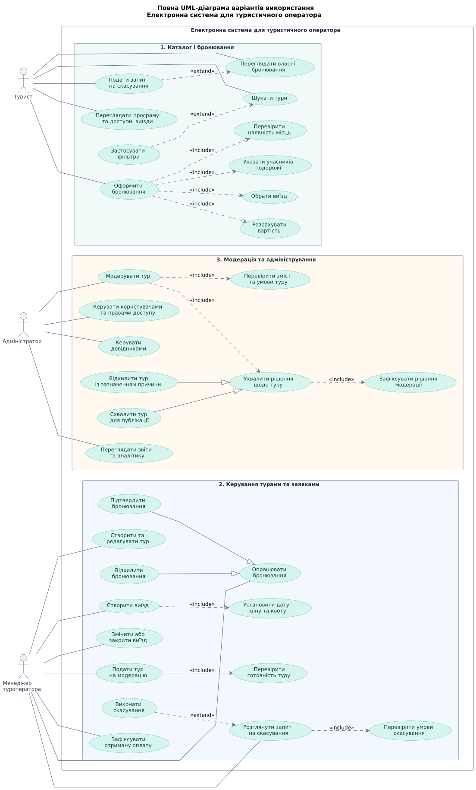
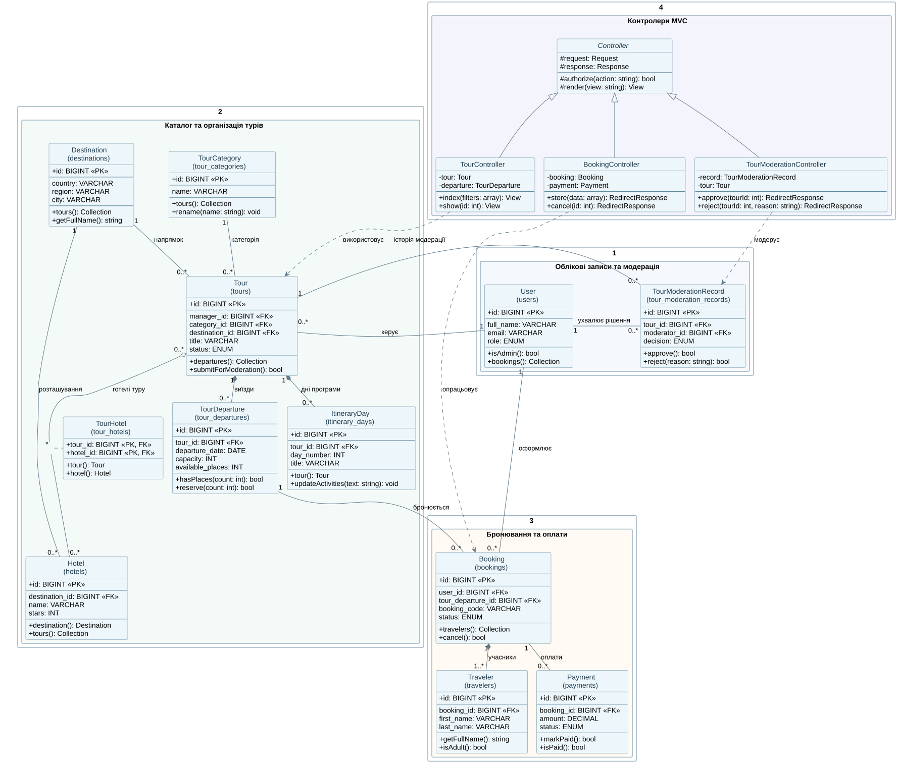
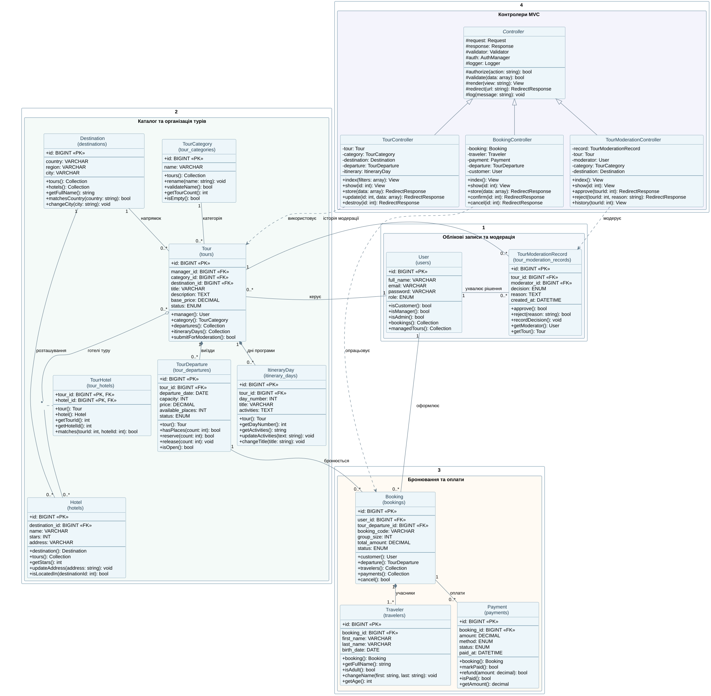

# Архітектура електронної системи для туристичного оператора

## 1. Загальна характеристика системи

**Назва:** Електронна система для туристичного оператора.

**Предметна галузь:** автоматизація діяльності туристичного оператора, управління туристичними пропозиціями, організація виїздів та обробка бронювань.

Електронна система для туристичного оператора — це веборієнтована інформаційна система, призначена для централізованого управління каталогом турів, програмами подорожей, графіками виїздів, бронюваннями та взаємодією з клієнтами.

Основною метою розроблення є автоматизація процесів організації туристичних поїздок, мінімізація ризику подвійного бронювання, забезпечення актуальності інформації про вартість і доступність туристичних пропозицій.

### Основні функціональні можливості

1. Реєстрація, автентифікація користувачів та розмежування прав доступу.
2. Створення, редагування, модерація та публікація туристичних пропозицій.
3. Формування маршрутів і програм подорожей.
4. Керування датами виїздів, місткістю груп і доступними місцями.
5. Пошук і фільтрація турів за визначеними критеріями.
6. Оформлення та опрацювання бронювань.
7. Облік учасників подорожей і підтверджених оплат.
8. Адміністрування користувачів та довідкових даних.
9. Формування звітності та аналітичних показників.

### Категорії користувачів

**Турист (Customer)** — переглядає туристичні пропозиції, здійснює пошук, оформлює бронювання, зазначає учасників подорожі та контролює стан власних заявок.

**Менеджер туроператора (Tour Manager)** — створює туристичні пропозиції, формує програми й дати виїздів, керує квотами місць, опрацьовує бронювання та фіксує відомості про оплату.

**Адміністратор (Administrator)** — здійснює модерацію турів, керує користувачами, довідковою інформацією, правами доступу та переглядає загальносистемні звіти.

## 2. Архітектура програмної системи

Для реалізації вебзастосунку обрано клієнт-серверну архітектуру з використанням шаблону MVC (Model–View–Controller).

**Технологічний стек:**
- Мова програмування: PHP.
- Серверний фреймворк: Laravel.
- Система керування базами даних: MySQL.
- ORM: Eloquent.
- Представлення: Blade, HTML, CSS, JavaScript.
- Контроль версій: Git та GitHub.

Архітектура MVC передбачає розподіл відповідальності між трьома компонентами:

- **Model** — представляє предметні сутності, їхні атрибути, зв'язки та операції доступу до даних.
- **View** — формує користувацький інтерфейс і відображає результати обробки запитів.
- **Controller** — приймає HTTP-запити, координує перевірку даних, авторизацію та виконання прикладної логіки.

Основними моделями визначено User, Tour, TourCategory, Destination, TourDeparture, ItineraryDay, Hotel, Booking, Traveler, Payment і TourModerationRecord.

Для реалізації зв'язку між турами та готелями передбачено проміжну таблицю tour_hotels.

Робота з даними здійснюватиметься через Eloquent ORM із використанням відповідних відношень між моделями.

## 3. UML-діаграма варіантів використання

Діаграма варіантів використання відображає основних акторів системи та доступні їм функціональні можливості.

Для моделювання визначено трьох акторів: Турист, Менеджер туроператора та Адміністратор.

Функціональні можливості згруповано за такими напрямами:

1. Каталог і бронювання.
2. Керування турами та заявками.
3. Модерація та адміністрування.

На діаграмі використано відношення асоціації, включення (include), розширення (extend) та узагальнення (generalization).

*Рисунок 1 — UML-діаграма варіантів використання електронної системи для туристичного оператора.*

## 4. Повний опис Use Case «Оформити бронювання»

### 4.1. Загальні відомості

**Use Case Name:** Оформити бронювання.

**Scope:** Електронна система для туристичного оператора.

**Level:** User-goal.

**Primary Actor:** Турист.

### 4.2. Зацікавлені сторони

**Турист:** зацікавлений у швидкому та коректному оформленні бронювання, отриманні актуальної інформації про вартість і доступність місць.

**Менеджер туроператора:** зацікавлений в отриманні достовірних відомостей про заявки та можливості їх подальшого опрацювання.

**Туристичний оператор:** зацікавлений у правильному обліку бронювань, уникненні перевищення квот місць та забезпеченні узгодженості інформації.

### 4.3. Preconditions (передумови)

1. Турист має доступ до електронної системи.
2. У каталозі наявний опублікований тур із доступними виїздами.
3. Система містить актуальні відомості про вартість і квоти місць.
4. Сервіс бронювання та база даних доступні.
5. Для підтвердження бронювання турист має бути автентифікований.

### 4.4. Main Success Scenario (головний успішний сценарій)

1. Турист відкриває каталог туристичних пропозицій.
2. Система відображає перелік доступних турів.
3. Турист обирає тур і переходить до перегляду його програми.
4. Система відображає опис туру та перелік доступних виїздів.
5. Турист вибирає потрібний виїзд і розпочинає оформлення бронювання.
6. Система відображає форму введення інформації про учасників.
7. Турист зазначає кількість учасників і заповнює персональні дані.
8. Система перевіряє коректність введеної інформації.
9. Система перевіряє наявність місць для вибраного виїзду.
10. Система розраховує загальну вартість бронювання.
11. Турист перевіряє інформацію та підтверджує оформлення.
12. Система повторно перевіряє доступність місць і в межах атомарної операції створює бронювання та резервує необхідну кількість місць.
13. Система присвоює бронюванню початковий статус pending, установлює термін тимчасового резервування та зберігає інформацію.
14. Турист отримує підтвердження створення заявки й можливість переглянути її поточний стан.

### 4.5. Success Guarantee (умови успішного завершення)

Бронювання успішно створено та збережено в базі даних. Для вибраного виїзду зарезервовано необхідну кількість місць, заявці присвоєно відповідний статус. Інформація доступна туристу та менеджеру для подальшого опрацювання.

### 4.6. Extensions (альтернативні сценарії)

**3a. Тур недоступний.** Якщо тур знято з публікації, система повідомляє про неможливість бронювання.

**4a. Відсутні доступні виїзди.** Система відображає відповідне повідомлення та припиняє оформлення.

**8a. Некоректні дані учасників.** Система повідомляє про помилки введення та пропонує виправити інформацію.

**9a. Недостатня кількість місць.** Система повідомляє про обмеження та пропонує змінити параметри бронювання.

**10a. Зміна вартості подорожі.** Система повторно розраховує ціну та вимагає підтвердження оновленої вартості.

**12a. Конкурентне бронювання.** Якщо доступні місця були зарезервовані іншим користувачем, операція скасовується без створення некоректного бронювання.

**12b. Помилка збереження.** У разі збою бази даних система виконує відкат незавершеної транзакції.

**13a. Завершення терміну резервування.** Якщо бронювання не підтверджено протягом установленого терміну, резервування припиняється, а місця звільняються.

### 4.7. Special Requirements (спеціальні вимоги)

Система повинна забезпечувати:

- цілісність інформації про бронювання;
- атомарність операцій резервування місць;
- перевірку коректності персональних даних;
- захист інформації користувачів;
- запобігання перевищенню квот при одночасних запитах;
- контроль життєвого циклу бронювання.

### 4.8. Technology and Data Variations List

Взаємодія користувача із системою здійснюється через вебінтерфейс. Дані зберігаються у реляційній базі даних MySQL. Для перевірки введених даних і забезпечення цілісності бронювань передбачається використання серверних механізмів Laravel та транзакцій бази даних.

### 4.9. Frequency of Occurrence

Сценарій виконується за ініціативою туриста під час оформлення подорожі. Фактична частота використання визначатиметься на основі статистики роботи системи.

### 4.10. Miscellaneous

Необхідно додатково визначити тривалість тимчасового резервування, правила підтвердження заявки та порядок обробки повторних запитів на створення бронювання.

## 5. UML-діаграма класів

UML-діаграма класів відображає статичну структуру програмної системи, її основні сутності, атрибути, операції та взаємозв'язки.

Для моделювання використано відношення асоціації, агрегації, композиції та наслідування з відповідними кратностями.

### 5.1. Спрощена діаграма класів

Спрощена діаграма відображає основні класи системи, їхні ключові атрибути, операції та відношення. Вона призначена для загального представлення архітектури.

*Рисунок 2 — Спрощена UML-діаграма класів.*

### 5.2. Повна діаграма класів

Повна UML-діаграма деталізує атрибути й операції класів, їхні типи, кратності відношень та взаємодію контролерів із предметними моделями.

*Рисунок 3 — Повна UML-діаграма класів електронної системи для туристичного оператора.*

Вихідний код обох версій збережено у форматі PlantUML (.puml), що забезпечує можливість подальшого редагування та підтримки проєктної документації.

## 6. Висновок

У результаті проєктування визначено архітектурну основу електронної системи для туристичного оператора, сформовано структуру основних предметних сутностей і встановлено відношення між ними. Моделювання варіантів використання дозволило формалізувати функціональні вимоги, розподіл повноважень користувачів і послідовність виконання ключових операцій.

Використання UML-діаграм та архітектурного шаблону MVC створює передумови для послідовної реалізації серверної бізнес-логіки, моделей Eloquent, контролерів і структури реляційної бази даних. Особливу увагу приділено забезпеченню цілісності бронювань, обліку доступних місць і контролю станів туристичних пропозицій.
